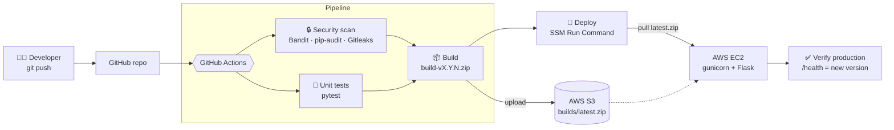

# CI/CD Pipeline with GitHub Actions & AWS

Assignment 2 – DevOps. A Flask web app that goes from **code change to live production automatically**:

**Code change → git push → security scan + unit tests → build → artifact in S3 → deploy to EC2 → verified live**

## Architecture



## Pipeline stages (`.github/workflows/cicd.yml`)

| # | Job | What it does | Fails the pipeline if… |
|---|-----|--------------|------------------------|
| 1 | 🔒 Security Scan | Bandit (SAST), pip-audit (dependency CVEs), Gitleaks (secrets in git history) | a medium+ code issue, vulnerable dependency or leaked secret is found |
| 1 | 🧪 Unit Tests | `pytest` – 9 tests on pages, health endpoint and build metadata | any test fails |
| 2 | 📦 Build & Upload to S3 | Creates `build-v<APP_VERSION>.<run#>.zip`, uploads it to `s3://<bucket>/builds/` and as `latest.zip` | upload fails |
| 3 | 🚀 Deploy | Uses AWS Systems Manager to make the EC2 server download `latest.zip` from S3 and run `deploy/deploy.sh` | the server-side install or health check fails (auto-rollback) |
| 4 | ✅ Verify Production | Calls `http://<server>/health` and checks it reports the version that was just built | production isn't serving the new version |

Bonus DevSecOps: **CodeQL** (`.github/workflows/codeql.yml`) and **Dependabot** (`.github/dependabot.yml`) also run on every push.

## AWS setup

| Resource | Purpose |
|----------|---------|
| S3 bucket (private, versioned) | Stores every build artifact |
| EC2 t3.micro, Amazon Linux 2023 | Production web server (port 80) |
| IAM role `EC2-CICD-Role` | Lets the server read S3 and receive SSM commands |
| IAM user `github-actions-deployer` | Least-privilege keys used only by GitHub Actions |

GitHub **secrets**: `AWS_ACCESS_KEY_ID`, `AWS_SECRET_ACCESS_KEY`
GitHub **variables**: `AWS_REGION`, `S3_BUCKET`, `EC2_INSTANCE_ID`

## Make a change (the demo)

1. Edit `APP_VERSION` and/or `BANNER_MESSAGE` near the top of `app.py`.
2. `git commit -am "Change banner" && git push`
3. Watch the **Actions** tab → when it's green, open the production URL from the run summary.

## Run locally

```bash
python3 -m venv .venv && source .venv/bin/activate
pip install -r requirements-dev.txt
pytest -v
python app.py   # http://127.0.0.1:5000
```
